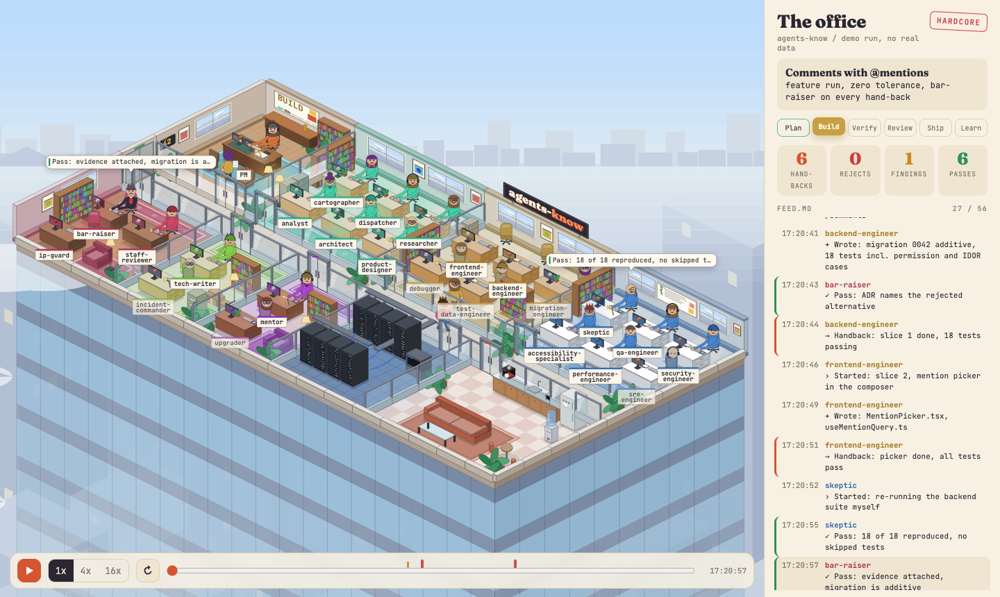
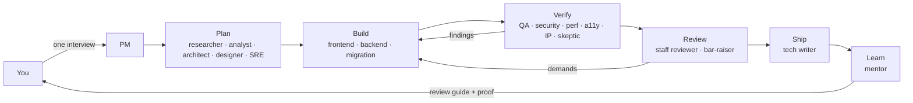

<div align="center">

# agents-know

### Your AI says it's done. agents-know makes it prove it.

**One Claude Code plugin. A whole software company behind it.**
A PM agent staffs every job from 24 specialists, and only calls in the ones the work needs.
A **skeptic** re-runs your tests and tries to break every "done".
A **bar-raiser** rejects anything that comes without evidence.
A **safety hook** makes sure nothing ever drops your database.
You get working code, the proof that it works, and a guide for reviewing it.

<picture>
  <source media="(prefers-color-scheme: dark)" srcset="office/prototype-dark.png">
  
</picture>

<sub>The office: a replay of a demo run in <code>hardcore</code> mode. Open <a href="office/prototype.html"><code>office/prototype.html</code></a> to watch it.</sub>

[](LICENSE)


[Install](#install) · [Company modes](#company-modes) · [Status](#status) · [How it works](#how-it-works) · [Commands](#commands) · [The team](#the-team) · [Safety](#safety) · [Roadmap](docs/ROADMAP.md)

</div>

---

## The problem

AI coding agents are fast. They also:

- say **"done"** when the tests were never run, or were edited until they passed;
- skip the boring parts: error states, accessibility, auth checks, migrations that keep the data;
- review their own work, so nobody really reviews it;
- run `DROP TABLE` or `git push --force` if they think it will fix the problem.

You end up acting as the QA team, the security reviewer and the staff engineer for everything the AI produced.

## The fix

agents-know gives the AI the structure of a real product company and makes it follow that structure.

| Without agents-know | With agents-know |
| --- | --- |
| One agent plans, codes and grades its own work | Separate specialists. Reviewers, the skeptic and the bar-raiser are **read-only**, so they can't "fix" their way to a pass |
| "Done" means the agent stopped | "Done" means a written definition of done is met, with proof |
| Quality depends on your prompt | Every run goes through the same gates: tests, security, performance, accessibility, IP and staff review |
| Whether a destructive command runs is luck | A hook **blocks** destructive SQL, remote database access, force pushes, `.env` reads and data-dropping migrations in every session |
| You review a giant diff and hope | You get a review guide: who did what, where to look first, and the business logic of each flow |
| You learn nothing | A staff-engineer mentor explains what was built and why |

## Company modes

You choose how demanding the company is, once per run (or set a default in `/agents-know:setup`).

| Mode | The company is... | What you get |
| --- | --- | --- |
| `startup` | Moving fast | MVP quality, tests plus a skeptic, cheapest models, a small team |
| `standard` | A solid product team (default) | Every gate, independent review before the staff review |
| `bigtech` | Process-heavy | Design docs and ADRs, the full verify suite, a bar-raiser on every slice |
| `hardcore` | A toxic boss | Zero tolerance. The bar-raiser rejects until the work is excellent, the skeptic attacks every claim. Blunt about the work, never about you |

```text
bar-raiser: No evidence. Rejected.
bar-raiser: You tested the happy path. Where is the error state? Rejected.
```

Two agents are the reason the output is better. The **skeptic** re-runs the tests and builds itself and tries to prove "done" is false (edited or skipped tests, untested states, fake passes). The **bar-raiser** scores every hand-back against the definition of done and sends it back with concrete demands. Two more are the reason fewer tokens are spent. The **cartographer** keeps a compact repo map so agents read it instead of exploring the repository. The **dispatcher** picks the smallest team and the cheapest adequate model for each role. Details are in [references/company-modes.md](references/company-modes.md).

## Install

```text
/plugin marketplace add hacagahasanli/agents-know
/plugin install agents-know@agents-know
```

Recommended, because the agents use its engineering skills:

```text
/plugin marketplace add addyosmani/agent-skills
/plugin install agent-skills@addy-agent-skills
```

Then run this once per workspace:

```text
/agents-know:setup
```

It asks about your repositories, stack, language and hard stops, and saves a profile to `~/.agents-know/profiles/`.

## Your first run

Fix a real bug:

```text
/agents-know:fix "Users get logged out after editing their profile"
```

Here is what happens:

1. The **debugger** reproduces the bug with a failing test, proves the root cause and finds every place the same bug occurs.
2. An **engineer** applies the smallest safe fix.
3. **QA** and the **staff reviewer**, both read-only, verify the fix. Their findings go back to the engineer until every one is closed.
4. You get the diff, the proof and a short explanation. Nothing is committed or pushed; that stays your call.

Build a feature:

```text
/agents-know:feature "Comments on tasks, with @mentions and notifications"
```

Build a whole product, learning from tools you already know:

```text
/agents-know:forge "Like Jira, but with Linear's simplicity; we need the backlog, board and sprints"
```

The PM interviews you **once**, then works on its own until the definition of done is met.

## How it works



- The six roles are what you see. The specialists behind them (and the `dispatcher` that staffs each phase) are loaded only when the work needs them; the `cartographer` maps the repository first if it has no fresh map.
- Work is split into **thin vertical slices**. Each slice is built, tested and checked before the next one starts.
- Every phase has **exit criteria**, and the PM can't move on until they are met.
- Only the PM talks to you. Agents report to the PM and log one-line events to a live feed:

  ```bash
  tail -f ~/.agents-know/runs/latest/feed.md
  ```

- If a run is interrupted, `/agents-know:resume` continues from the run ledger without repeating finished work.

## Commands

| Command | Use it for |
| --- | --- |
| `/agents-know:setup` | Create your profile (repos, stack, language, default company mode, hard stops) |
| `/agents-know:task <change>` | A small change, with only the agents it needs; escalates if it grows |
| `/agents-know:fix <bug>` | Reproduce → root cause → smallest fix → proof |
| `/agents-know:feature <what>` | A feature inside an existing product, at the same quality bar |
| `/agents-know:forge <product>` | A new product: one interview, then autonomous work |
| `/agents-know:backlog [profile]` | Rank your backlog and work through it task by task |
| `/agents-know:status` | Where the run stands: phase, tasks, open findings |
| `/agents-know:resume` | Continue an interrupted run |
| `/agents-know:learn [topic]` | Ask the mentor anything about what was built |
| `/agents-know:recap` | What the agents did, told as an AI-engineering case study |

## The team

<details>
<summary><b>All 24 specialists</b></summary>

| Role | Agent | What it does |
| --- | --- | --- |
| Product manager | main session | Interviews you, plans, briefs every agent, enforces exit criteria |
| Researcher | `researcher` | Maps how reference products behave into a feature matrix |
| Business analyst | `analyst` | Writes the PRD with testable acceptance criteria |
| Architect | `architect` | Data model, API contracts, authorization, ADRs, slices |
| Product designer | `product-designer` | Flows, screens, states and motion; design review of built UI |
| Frontend engineer | `frontend-engineer` | UI slices in your conventions, with tests |
| Backend engineer | `backend-engineer` | API, persistence and authorization, with tests |
| Migration engineer | `migration-engineer` | Imports from the tool you're replacing |
| Debugger | `debugger` | Failing test first, then the root cause and every sibling occurrence |
| QA engineer | `qa-engineer` | Test strategy, automated tests, parity checks (read-only) |
| Security engineer | `security-engineer` | Threat model and attacks on *your own* code (read-only) |
| Performance engineer | `performance-engineer` | Before/after measurements and regressions (read-only) |
| Accessibility specialist | `accessibility-specialist` | WCAG 2.2 AA audit (read-only) |
| IP guard | `ip-guard` | Checks that nothing was copied from reference products (read-only) |
| SRE | `sre-engineer` | SLOs, observability, load and failure drills, runbooks |
| Test data engineer | `test-data-engineer` | Realistic, anonymised pre-prod data covering every flow |
| Staff reviewer | `staff-reviewer` | Correctness, simplicity and convention fit (read-only) |
| Skeptic | `skeptic` | Re-runs tests and builds, tries to disprove every "done" claim (read-only) |
| Bar-raiser | `bar-raiser` | Scores hand-backs against the definition of done, sends them back with demands (read-only) |
| Cartographer | `cartographer` | Builds and updates the repo map so agents don't explore |
| Dispatcher | `dispatcher` | Smallest team, cheapest adequate model per role |
| Incident commander | `incident-commander` | Production incidents: timeline, mitigation and rollback plan, postmortem; never acts on production |
| Upgrader | `upgrader` | Dependency and CVE updates, one dependency per slice |
| Technical writer | `tech-writer` | Docs, review guide, commit plan |
| Mentor | `mentor` | Teaches you what was built and how the agents built it |

</details>

Small tasks use one or two agents. The full team only joins when the work needs it, and the company mode decides how much review sits on top.

## Safety

Safety is enforced by a hook, not by asking the model nicely.

**Always blocked, in every session:**

- `DROP`, `TRUNCATE`, `DELETE FROM` and bulk `UPDATE`
- database clients pointed at non-local hosts
- `dropdb`, `FLUSHALL` and similar commands
- deleting Docker volumes or Kubernetes resources, and `terraform destroy`
- force pushes and branch deletion
- recursive deletes outside build folders
- reading `.env` files
- migrations that drop or rename tables or columns

**Also blocked while a run is active:** commits, pushes, running migrations, discarding work and adding dependencies. The PM has to ask you first.

**Reviewers can't edit code.** The QA, security, performance, accessibility, IP, staff review, skeptic and bar-raiser agents are read-only, so a review can't quietly turn into a rewrite.

**Privacy by default.** Every stored field is classified, and secrets and private content stay out of logs and analytics.

The hook has its own test suite: `bash tests/guard.test.sh`. The design is described in [docs/SECURITY.md](docs/SECURITY.md).

## Status

This README says only what we have checked. Here is where things stand in v0.5:

| | State |
| --- | --- |
| Claude Code plugin | Works; `claude plugin validate .` passes in CI |
| Safety hook | 48 tests in `tests/guard.test.sh`, run in CI |
| Agent quality | Every agent rewritten and independently reviewed. See [docs/AGENT_QUALITY_AUDIT.md](docs/AGENT_QUALITY_AUDIT.md) |
| Evals | One scenario file per agent in [evals/](evals/). These are run by hand and **haven't been scored yet**. We'll publish results, not claims |
| Token savings | Designed in through the cartographer, the dispatcher and `startup` mode. **Not measured yet** |
| Other platforms | Codex, Cursor, OpenCode and Copilot are on the [roadmap](docs/ROADMAP.md) and **not supported yet** |
| The office | Replays a demo run today. Watching a live run is next |

## Backlog

Keep bugs and ideas in a backlog and let the PM work through them. The plugin ships a small MCP server (`backlog`) that stores each profile's backlog in `~/.agents-know/backlog/<profile>.json`. Add tasks from any MCP client, then run `/agents-know:backlog`. When the PM needs a decision, it asks you through the backlog. Finished tasks move to `done` with proof attached.

## Where things go

- Profiles: `~/.agents-know/profiles/<name>.md`
- Runs: `~/.agents-know/runs/<product>-<date>/`, holding the brief, ledger, research, specs, plans, reports and mentor notes
- Your repositories receive only product code, tests and docs. **Nothing is committed or pushed for you.**

## FAQ

**Does it work outside Claude Code?**
Not yet. Adapters for Codex, Cursor, OpenCode and GitHub Copilot are on the [roadmap](docs/ROADMAP.md). Each one will be marked as supported only after it has been tested, together with a note on which guarantees (hooks, read-only reviewers) still hold on that platform.

**Isn't a whole team overkill for a one-line change?**
Yes, so it doesn't send one. `/agents-know:task` uses only the agents a change needs, and escalates only if the change turns out to be bigger.

**How much does a run cost in tokens?**
That depends on the size of the work. `task` and `fix` are cheap, while `forge` on a whole product is a long run. The dispatcher picks the cheapest adequate model per role, `startup` mode keeps the team small, and `bigtech` and `hardcore` spend more on purpose. You can also set each agent's model in its definition.

**Does it copy the products I reference?**
No. The researcher studies their behaviour as a normal user, and the IP guard keeps their names, logos, copy and code out of your product. This is not legal advice.

## Contributing

New agents, gates and platform adapters are welcome. See [CONTRIBUTING.md](CONTRIBUTING.md).

```bash
claude plugin validate .
bash tests/guard.test.sh
```

## Acknowledgments

Built on the lifecycle and engineering skills of [addyosmani/agent-skills](https://github.com/addyosmani/agent-skills).

## License

[MIT](LICENSE)
