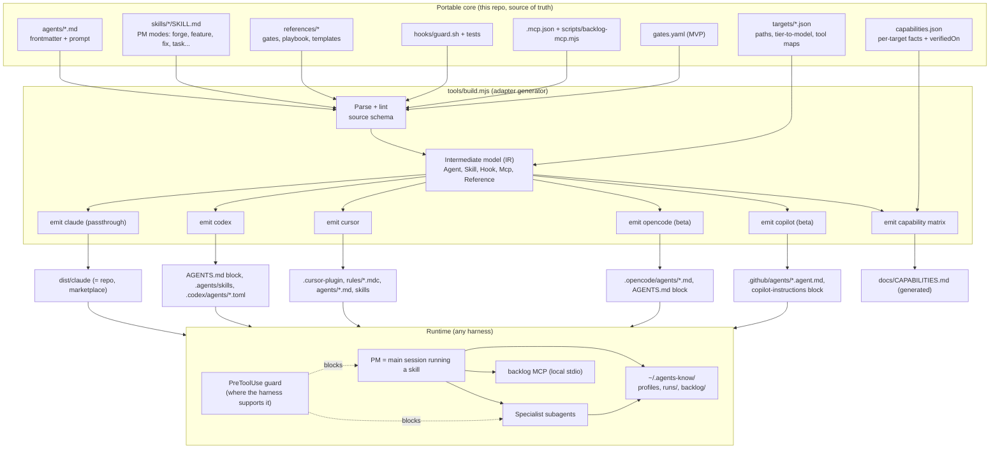

# agents-know: Architecture

Status: design for the MVP. Date: 2026-11-16. Decisions: `docs/adr/0002-portable-core-adapters.md`.
Labels: **Verified (doc)** = read in the vendor's official docs on 2026-11-16. **Assumption** = not confirmed in docs; must be verified by the implementer before the matching emitter is marked supported. **Recommendation** = our design choice.

Method note: the official pages were read through a fetch tool that summarises pages. Field names below come from those summaries. Before coding each emitter, re-read the raw page and record the date in `targets/<id>.json` (`verifiedOn`).

## 1. Principles

1. **One source, no hand-maintained copies.** The agents, skills and references in this repository are the source. Everything for other harnesses is generated and never edited by hand.
2. **Claude Code plugin format is the source format.** It already works, is validated by `claude plugin validate`, and the unknown frontmatter fields are silently ignored by Claude Code (Verified, sub-agents doc), so we can add portable metadata without breaking it. No file moves are needed.
3. **Core is markdown plus a few scripts.** Agents, skills, references and templates are text. Behaviour that needs enforcement lives in `hooks/guard.sh`, which is optional per harness.
4. **Degrade loudly.** Where a harness lacks a feature, the generator emits the closest native equivalent and records the downgrade in the generated capability matrix. It never pretends.
5. **No network and no code execution at install or build time beyond Node.** The generator has zero runtime dependencies.
6. **Shared state is harness-neutral.** Runs, profiles and the backlog live in `~/.agents-know/` and are identical on every harness, so a run started in one harness can be resumed in another.

## 2. Architecture



Layers: **Core** (text and scripts), **Generator** (pure function from core and target config to files), **Adapters/emitters** (one per harness, isolated, each with its own golden tests), **Runtime** (the harness itself; we do not ship one).

## 3. Repository layout (additions only)

```
agents/ skills/ references/ hooks/ scripts/ .mcp.json     existing, unchanged
gates.yaml                    machine-readable G0-G3 (MVP, see ROADMAP)
capabilities.json             per-target verified facts and dates
targets/<id>.json             path map, tier-to-model map, tool-name map, size limits
tools/build.mjs               CLI entry
tools/lib/{parse,ir,rewrite,emit-<id>,matrix,lint}.mjs
tools/schema/{agent,skill,target,manifest}.schema.json
tools/install.mjs             copies a built target into a project, marker-merge only
tests/adapters/               unit + golden + conformance (see 7)
dist/                         gitignored; release artefacts per tag
docs/CAPABILITIES.md          generated matrix
```

## 4. Source schema and intermediate model

### 4.1 Source agent file (`agents/<id>.md`)

Frontmatter fields in use today (Verified: this repo): `name`, `description`, `model`, `color`, `disallowedTools` (optional). Claude Code also supports `tools`, `permissionMode`, `skills`, `maxTurns`, `memory`, `isolation`, `effort` and others (Verified, sub-agents doc), but for **plugin-provided agents** it ignores `hooks`, `mcpServers`, `permissionMode` and `initialPrompt` (Verified). So least privilege for plugin agents must use `tools` or `disallowedTools`, and hooks must live in `hooks/hooks.json`.

Portable rules (enforced by `tools/lib/lint.mjs`):

| Field | Rule |
| --- | --- |
| `name` | kebab-case, equals the filename stem. Max 64 characters (Agent Skills limit, applied to be safe) |
| `description` | 1 to 1024 characters; one paragraph; says when to use the agent |
| `model` | one of `opus`, `sonnet`, `haiku`, `inherit`; mapped to a **tier**, never copied to other harnesses |
| `disallowedTools` or `tools` | tool names from the Claude set; mapped per target |
| body | at most 30,000 characters (Copilot limit, Verified); references use `${CLAUDE_PLUGIN_ROOT}/references/<file>` only |
| no other fields | extra fields fail lint, so the mapping stays complete |

### 4.2 Source skill file (`skills/<id>/SKILL.md`)

Follows the open Agent Skills spec (Verified, agentskills.io): `name` (max 64, lowercase, hyphens, equals directory name), `description` (max 1024). Existing extra fields: `argument-hint`, `disable-model-invocation`. These pass through to Claude and are translated elsewhere (see 5).

### 4.3 Intermediate model (IR)

```ts
type Tier = "reasoning" | "standard" | "inherit";       // opus -> reasoning, sonnet/haiku -> standard
type Access = "read-write" | "report-only";             // report-only = Edit denied; may write run reports and tests

interface Agent {
  id: string; description: string; body: string;        // body has placeholders resolved by rewrite()
  tier: Tier; access: Access; color?: string;
  allowedTools?: string[]; deniedTools: string[];       // Claude tool names
  references: string[];                                 // closure of reference files the body mentions
  source: string;                                       // path, for error messages
}
interface Skill {
  id: string; description: string; argumentHint?: string;
  invocation: "explicit-only" | "implicit";             // from disable-model-invocation
  body: string; files: string[];                        // supporting files under the skill dir
}
interface Hook { id: "guard"; event: "pre-tool-use"; tools: string[]; command: string; args: string[]; timeoutSec: number }
interface McpServer { id: string; command: string; args: string[]; env: Record<string,string> }
interface Core { version: string; agents: Agent[]; skills: Skill[]; references: string[]; hooks: Hook[]; mcp: McpServer[]; scripts: string[]; gates: object }
```

### 4.4 Target config (`targets/<id>.json`)

```jsonc
{
  "id": "codex", "status": "supported",           // supported | beta | experimental
  "verifiedOn": "2026-11-16",
  "paths": { "agents": ".codex/agents", "skills": ".agents/skills", "instructions": "AGENTS.md", "coreRoot": ".agents/agents-know" },
  "tierModels": { "reasoning": null, "standard": null },   // null = inherit; user may override with --models file
  "toolMap": { "Edit": "apply_patch", "Write": "apply_patch", "Bash": "Bash" },
  "limits": { "instructionsBytes": 24576, "agentBodyChars": null, "descriptionChars": 1024 },
  "features": { "hooks": "planned", "nativeReadOnly": false, "bundledMcp": "snippet" }
}
```

Defaulting `tierModels` to inherit is a Recommendation: model identifiers change quickly and differ per account, so the safe default is the user's own model. Users who want the cost split (reasoning agents on a strong model, builders on a cheaper one) pass `--models models.json`.

## 5. How one source agent maps to each target

Running example: `agents/security-engineer.md` (`model: opus`, `disallowedTools: Edit, NotebookEdit`, body references `${CLAUDE_PLUGIN_ROOT}/references/privacy-by-default.md`).

### 5.1 Placeholder and name rewriting (all non-Claude targets)

| Source text | Rewritten to |
| --- | --- |
| `${CLAUDE_PLUGIN_ROOT}/references/X` | `<coreRoot>/references/X` |
| `${CLAUDE_PLUGIN_ROOT}/scripts/X` | `<coreRoot>/scripts/X` |
| `${CLAUDE_PLUGIN_DATA}` | `~/.agents-know/state` |
| `/agents-know:<skill>` | Codex `$<skill>`; Cursor `/<skill>` (Assumption); OpenCode and Copilot "run the `<skill>` skill" |
| `agents-know:<skill>` and `agents-know:<agent>` | `<skill>` / `<agent>` |
| `agent-skills:<name>` | unchanged; guarded by the sentence "use when available" already present in agent text |

After rewrite, lint asserts no `CLAUDE_` token remains in non-Claude output.

### 5.2 Per-target mapping

| Concept | Claude Code (source) | Codex | Cursor | OpenCode (beta) | GitHub Copilot (beta) |
| --- | --- | --- | --- | --- | --- |
| Always-on charter | none (a plugin-root `CLAUDE.md` is not loaded, Verified); the PM skills carry the rules | `AGENTS.md` block between `<!-- agents-know:begin/end -->` markers, at most 24 KiB so the default 32 KiB `project_doc_max_bytes` is not hit (Verified) | `rules/agents-know.mdc` with `alwaysApply: true`, under 500 lines (Verified guidance) | `AGENTS.md` block (Assumption that OpenCode reads it) | `.github/copilot-instructions.md` block; `AGENTS.md` is also read (Verified) |
| Skill | `skills/<id>/SKILL.md` as is | `.agents/skills/<id>/SKILL.md` (Verified paths); `explicit-only` becomes `agents/openai.yaml` with `policy.allow_implicit_invocation: false` (Verified) | `skills/<id>/SKILL.md` in the plugin (Verified) | `.agents/skills/<id>/SKILL.md` shared with Codex (Assumption: location unverified; beta until confirmed) | `.github/skills/<id>/SKILL.md` (Assumption, from research) |
| Agent file | `agents/<id>.md` as is | `.codex/agents/<id>.toml`: `name`, `description`, `developer_instructions` = body (Verified required fields) | `agents/<id>.md` in the plugin or `.cursor/agents/<id>.md`: `name`, `description`, `model: inherit` (Verified) | `.opencode/agents/<id>.md`: `description`, `mode: subagent` (Verified) | `.github/agents/<id>.agent.md`: `name`, `description`, body at most 30,000 characters (Verified) |
| Tier to model | `model:` kept | `model` omitted (inherit) unless `--models`; `model_reasoning_effort` may be set from tier (Verified field exists) | `model: inherit` unless `--models` | `model` omitted unless `--models` | `model` omitted unless `--models` |
| Report-only access (`disallowedTools: Edit`) | frontmatter kept plus guard hook path rules | **not enforceable**: custom agent files do not honour `sandbox_mode`, approval or MCP overrides (Verified); instructed only, hook later | `readonly: true` (Verified); coarse: it also blocks the report and test writes these agents need, so emit `readonly: true` only for agents that write no files (none today); others instructed | `permissions: [{action: edit, resource: "*", effect: deny}]` is the documented shape (Verified) but would block reports; emit with a `resource` allow rule for the run directory (Assumption that later rules win, Verified: "last matching rule wins") | `tools` allowlist (Verified property); path-scoped write is not expressible, so instructed only |
| Tool names | Claude names | `apply_patch` matches as `Edit`/`Write` in hooks (Verified) | per Cursor tool names (verify at build time) | OpenCode `edit`, `bash` etc. (Assumption) | aliases such as `read`, `search`, `edit`, `execute` (Assumption) |
| Guard hook | `hooks/hooks.json`, `PreToolUse`, exit code 2 blocks (Verified) | `.codex/hooks.json` or `config.toml` `[hooks]`, `PreToolUse`, exit 2 or JSON deny; project hooks need the `.codex/` layer trusted and `/hooks` review (Verified). Payload shape differs from Claude: needs a payload adapter | `hooks/hooks.json` in the plugin or `.cursor/hooks.json` (`version: 1`), events `preToolUse`, `beforeShellExecution`, `beforeReadFile`; exit 2 blocks; other failures fail open unless `failClosed: true` (Verified). Cursor can also load Claude Code hooks (Verified claim; details unread) | no verified hook mechanism: absent | `.github/hooks/*.json` (`version: 1`), `preToolUse` exists; how a deny is expressed is not documented on the page read: Assumption |
| MCP (backlog) | `.mcp.json` | `.codex/config.toml` snippet `[mcp_servers.backlog]` (Assumption on syntax); subagents inherit parent MCP (Verified) | `mcp.json` at plugin root (Verified) | `mcp` key in `opencode.jsonc` snippet (Assumption) | repository MCP settings snippet; agent-level `mcp-servers` is not used in IDEs (Verified) |
| Install channel | plugin marketplace | copy by `tools/install.mjs` or `$skill-installer` for skills | Cursor marketplace / team marketplace or copy | copy | copy |

Rules that follow from the table:

- **Report-only agents are the hard case.** In Claude Code they are enforced twice: `disallowedTools` removes the edit tools and the guard hook restricts remaining writes to run reports and test files (Verified: `guard.sh`). No other target can express "write only reports and tests". The generator therefore marks report-only access as *instructed* in Codex, Cursor, Copilot and OpenCode, and the matrix says so.
- **No subagent support, or too limited.** If a future target has no custom subagents, the emitter falls back to *sequential persona mode*: the PM skill includes each agent's prompt as a section and runs the roles one after another in one context. Context isolation and read-only separation are lost and the matrix marks both *absent*. Not built in the MVP; designed so the IR already carries what it needs.
- **PM skills on non-Claude harnesses.** The PM is the main session that has loaded a skill. Spawning syntax differs (Codex spawns by agent name; Cursor and Copilot delegate by description). The generated PM skill text keeps role names and adds a one-line per-target note on how to invoke a named subagent; the verified call syntax is recorded in `targets/<id>.json` (`spawnHint`).

## 6. Capability matrix

Legend: **E2** enforced by a hook or native permission the agent cannot skip; **E1** enforced by coarse native setting; **E0** instructed only (prompt); **none** absent. `(V)` Verified in docs on 2026-11-16; `(A)` Assumption to verify before the emitter ships.

### 6.1 What the harness provides

| Capability | Claude Code | Codex | Cursor | OpenCode | Copilot |
| --- | --- | --- | --- | --- | --- |
| Skills (SKILL.md, progressive disclosure) | yes (V) | yes (V) | yes (V) | (A) | (A) |
| Custom subagents from files | yes, md (V) | yes, toml (V) | yes, md (V); also reads `.claude/agents` (V) | yes, md (V) | yes, `.agent.md` (V) |
| Per-subagent tool restriction | yes: `tools`, `disallowedTools` (V) | no for sandbox, approval, MCP (V) | coarse: `readonly` (V) | yes: permission rules (V) | coarse: `tools` list (V) |
| Blocking pre-tool hook | yes (V) | yes, Bash, apply_patch, MCP; "a useful guardrail, not a complete enforcement boundary" (V) | yes, many events (V) | none verified | event exists; deny semantics (A) |
| Hook payload identifies the calling subagent | yes: `agent_type` (V: used by `guard.sh`) | (A) | (A) | n/a | (A) |
| Bundled MCP | yes (V) | config snippet (A) | yes (V) | config snippet (A) | partial (V) |
| Always-on instruction file | skills only | `AGENTS.md`, 32 KiB default (V) | rules `.mdc`, `AGENTS.md` (V) | `AGENTS.md` (A) | instructions file, `AGENTS.md` (V) |
| Explicit-only skills | `disable-model-invocation` (V) | `allow_implicit_invocation: false` (V) | (A) | (A) | agent property `disable-model-invocation` (V) |

### 6.2 What agents-know can guarantee on each (MVP state)

| Guarantee | Claude Code | Codex | Cursor | OpenCode | Copilot |
| --- | --- | --- | --- | --- | --- |
| Destructive SQL, infra deletion, force push, secret-file reads blocked | E2 | E0 (E2 in V1 after payload adapter) | E0 (E2 in V1) | E0 | E0 |
| Commit, push, migrations, new dependencies blocked while a run is active | E2 | E0 | E0 | E0 | E0 |
| Verifier agents cannot change product code | E2 | E0 | E1 (conditional, see 5.2) | E1 (path rules, A) | E0 |
| Gates G0 to G3 and evidence required before "done" | E0 by the PM, plus post-hoc evidence validator | same | same | same | same |
| Context isolation between specialists | yes (V) | yes (V) | yes (V) | yes (V) | (A) |
| Shared run state and resume across harnesses | yes | yes | yes | yes | yes |

The gates themselves are always E0, because they are process, not tool calls. What we add is the **evidence validator** (`tools/validate-run.mjs`): it reads a run directory and fails if a gate has no evidence rows, a hand-back has an empty evidence table, or a not-verified list is missing. It works on any harness because it only reads files.

### 6.3 Generated, not hand-written

`docs/CAPABILITIES.md` is generated from `capabilities.json` and `targets/*.json` by `tools/lib/matrix.mjs`. CI fails if the committed file differs from the generated one, and the README links to it instead of repeating it. A target not re-verified within 60 days gets a warning in CI (Recommendation).

## 7. Adapter generator: interfaces and contracts

### 7.1 CLI

```text
node tools/build.mjs --target <claude|codex|cursor|opencode|copilot|all> [--out dist] [--models models.json] [--check]
node tools/install.mjs --target <id> --into <project-dir> [--apply]        # default is a dry run that prints a diff
node tools/validate-run.mjs <run-dir>                                      # evidence validator
```

| Exit code | Meaning |
| --- | --- |
| 0 | success (or `--check` found no difference) |
| 1 | lint or schema error in the source (message names file and field) |
| 2 | `--check` found a difference between committed and generated output |
| 3 | target limit exceeded (size, name length) or unresolved placeholder |

### 7.2 Input contract

1. Source tree as in section 3. Agent and skill frontmatter validated against `tools/schema/agent.schema.json` and `skill.schema.json`.
2. `targets/<id>.json` validated against `target.schema.json` (shape in 4.4).
3. Optional `models.json`: `{ "reasoning": "<model id>", "standard": "<model id>" }` per target key. Passed through verbatim; the generator does not know model names.

### 7.3 Output contract

Each target writes into `<out>/<id>/` and a `MANIFEST.json`:

```jsonc
{
  "generator": "agents-know-build", "generatorVersion": "0.5.0", "sourceVersion": "0.5.0",
  "target": "codex", "targetStatus": "supported", "verifiedOn": "2026-11-16",
  "files": [{ "path": ".codex/agents/security-engineer.toml", "sha256": "…", "kind": "agent", "from": "agents/security-engineer.md" }],
  "downgrades": [{ "agent": "security-engineer", "feature": "report-only-access", "level": "E0" }]
}
```

Guarantees: deterministic (same input gives identical bytes, no timestamps in files); every generated file starts with a one-line `generated by agents-know; do not edit` comment where the format allows comments; every `downgrades` entry feeds the matrix; instruction-file output is a marker-delimited block, and `install.mjs` only replaces text between markers, never anything else, and refuses to write outside `--into`.

### 7.4 Failure behaviour

Unknown frontmatter field, missing reference, size over limit, duplicate name after case folding, unresolved placeholder, or an emitter producing a file that does not parse back (TOML, YAML, JSON) all exit non-zero with the file and field. A target with `status: beta` still builds but its `MANIFEST.json` and README banner say beta.

### 7.5 Tests (MVP)

| Level | What | Tooling |
| --- | --- | --- |
| Unit | frontmatter parser, rewriter (every placeholder row in 5.1), tier mapping, access derivation | `node:test`, no dependencies |
| Golden | build each target from a small fixture source (two agents, two skills, one hook) and diff against committed snapshots | `node:test` + `--check` |
| Conformance | on the real source: every agent and skill appears in every target; outputs parse (TOML, YAML, JSON); no `CLAUDE_` token in non-Claude output; every referenced file exists in the output; size limits hold (AGENTS.md block under 24 KiB; Copilot body under 30,000); idempotence (build twice, identical hashes) | `node:test` |
| Source lint | real `agents/` and `skills/` pass schema | `node tools/build.mjs --target claude --check` |
| Plugin validity | `claude plugin validate .` (Verified command) | CI step, skipped if the CLI is absent |

## 8. Runtime design that does not change per harness

- **State**: `~/.agents-know/{profiles,runs,backlog,state}`. Run id naming, ledger and feed are plain files (Verified: `pm-playbook.md`).
- **Run registry**: `scripts/run.sh start|stop|list` writes the active-run registry the guard reads. Takes the data directory as an argument, so a non-Claude target passes `~/.agents-know/state`.
- **Hook interface**: the guard reads a JSON payload on stdin and exits 2 with a message on stderr to block. This matches Claude Code, Codex and Cursor semantics (all Verified for exit code 2), which is why a thin per-harness payload adapter, not a rewrite, is the V1 plan.
- **Failure design**: if hooks are absent, the PM text still carries the hard stops (E0). If the backlog MCP is absent, `backlog` mode reports it and stops; every other mode works. If `~/.agents-know` is unwritable, `setup` fails with the path, and nothing else starts.

## 9. Non-goals of this architecture

No runtime of our own, no daemon, no database, no remote service, no auto-update. Updating means installing a new release artefact. Gemini CLI and other harnesses are added by writing one `emit-<id>.mjs` plus one `targets/<id>.json`; they are out of MVP.

## 10. Open items to verify before coding

| Item | Why | Owner action |
| --- | --- | --- |
| Codex and Cursor hook payload field names (tool name, file path, agent identity) | Guard parses Claude's payload with regular expressions | Capture real payloads in a throwaway repo; store as fixtures |
| OpenCode skill location and AGENTS.md support | Marked (A) | Read raw docs; promote or demote status |
| Copilot skill location, tool aliases, hook deny semantics | Marked (A) | Read raw docs; promote or demote |
| Cursor `.md` vs `.mdc` for rules | Docs disagree (rules page says `.mdc` is required; plugin page accepts `.md`) | Emit `.mdc` (works under both readings); re-check at release |
| Whether Cursor loads Claude Code hooks as is | One page says yes; details unread | Test in a throwaway repo; if yes, the Cursor guard needs no adapter |
