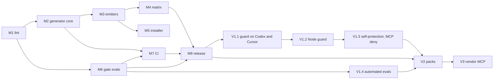

# agents-know: Roadmap

Status: plan for owner approval. Date: 2026-11-16. Implements path C (staged) from `docs/MARKET_RESEARCH.md`; scope reasons in `docs/PRODUCT_STRATEGY.md`.
Estimates are focused working days for one maintainer who knows the codebase (Assumption; not measured). Priority: **P0** blocks the first public release, **P1** should ship with it, **P2** next, **P3** later.

## 1. Release ladder

| Release | Theme | Gate to start | Rough effort |
| --- | --- | --- | --- |
| **MVP (v0.5)** | Publishable: portable core, generator with tests, gate evals, CI, honest docs | now | 8 to 10 days (5-day cut in section 2.3) |
| **V1 (v0.6 to v0.9)** | Trust and adoption: guard on more harnesses, automated evals, cost visibility, provenance | MVP released | 3 to 4 weeks |
| **V2** | Ops packs: thin, separate plugins on the same PM loop, repo data only | Entry conditions in 4 | per pack 1 to 2 weeks |
| **V3** | Vendor MCP integrations, consumed not rebuilt | V2 packs in use, data-classification policy written | per integration 1 week |
| Beyond | HR, recruiting, company intelligence | privacy design, legal review, more than one maintainer; otherwise never | not scheduled |

## 2. MVP

### 2.1 Scope

| ID | Item | Pri | User value | Depends on | Complexity | Days |
| --- | --- | --- | --- | --- | --- | --- |
| M0 | Release hygiene: root `SECURITY.md` (reporting channel, scope, response time), `CONTRIBUTING.md`, issue templates, `CODEOWNERS` for `hooks/`, `scripts/`, `tools/`; manifests use a public author attribution chosen by the owner; scan of the tree for private identifiers (names, hosts, paths, emails) before the first push; README install uses a real `<owner>/agents-know` | P0 | Trust at first glance; nothing private published | none | Low | 0.5 |
| M1 | Source schema and lint: `tools/schema/*.json`, `tools/lib/lint.mjs`; rules from `ARCHITECTURE.md` 4.1 and 4.2 (names, description length, body size, reference closure, no stray fields) | P0 | Catches broken agents and skills before users do (open problem in the sample: skills that do not fire, missing references) | none | Low | 0.5 |
| M2 | Generator core: parser, IR, placeholder rewriter, `MANIFEST.json`, deterministic output, `--check`, exit codes; `claude` target as passthrough | P0 | The one mechanism all targets use | M1 | Medium | 1 |
| M3 | Emitters: **Codex** (`AGENTS.md` block, `.agents/skills`, `.codex/agents/*.toml`, `openai.yaml`), **Cursor** (plugin layout, `.mdc` rule, agents with `readonly` where valid, skills, `mcp.json`) as `supported`; **OpenCode** and **Copilot** as `beta` | P0 (Codex, Cursor), P1 (OpenCode, Copilot) | Same company on the other three most-used harnesses | M2; open items 10 in ARCHITECTURE verified for each target before it is marked supported | Medium | 2.5 |
| M4 | Capability matrix: `capabilities.json`, `targets/*.json`, generated `docs/CAPABILITIES.md`, README links to it, CI fails on drift | P0 | The honest-portability differentiator | M3 | Low | 0.5 |
| M5 | `tools/install.mjs`: dry run by default, marker-delimited merge into `AGENTS.md` and `copilot-instructions.md`, never writes outside `--into`, idempotent | P1 | One-command install on non-Claude harnesses | M3 | Low | 0.5 |
| M6 | Gate evals (see 2.2) | P0 | Proof that "done means proven" is more than text | M1 | Medium | 2 |
| M7 | CI: GitHub Actions on Linux, macOS and Windows: lint, generator unit, golden and conformance tests, `--check` drift, guard corpus, backlog MCP smoke test, no-network grep of `hooks/` and `scripts/`, `claude plugin validate` when the CLI is available; actions pinned by commit SHA | P0 | Windows and macOS breakage is the most common complaint class in the sample | M2, M6 | Low | 0.5 |
| M8 | Release: tag `v0.5.0`, artefacts per target with checksums, README restructured around the three differentiators and the matrix, one reproducible 5-minute demo (a small repo fixture run through `task` mode with the evidence validator at the end), repository description and topics | P0 | Discoverability and first-run success | M4, M6, M7 | Low | 1 |

### 2.2 Gate evals (M6) in detail

| Part | What | Deterministic? |
| --- | --- | --- |
| `gates.yaml` | G0 to G3 as data: id, check, required evidence kind (command output, file path, count table, screenshot path), applies-to modes (product, feature, fix, task). Generated from, and checked against, `references/quality-gates.md` | yes |
| `tools/validate-run.mjs` | Reads a run directory. Fails if: a gate in scope has no evidence row; a hand-back has an empty evidence table or lacks a not-verified list; the ledger lacks a decision line for a lifted stop; a critical or high finding is open at G3 | yes |
| Guard corpus | Existing 46 cases kept (F1 fixed in 0.5.0); add cases for F1 (fix it), F3 (must-not-block prose and heredocs), F2 (documented known-allowed), F4; runs on three operating systems | yes |
| Planted-defect fixtures | Three tiny fixture repos under `evals/fixtures/`: (1) **security**: an endpoint with an object-level authorization gap and a string-built query; (2) **accessibility**: a form with an unlabelled input and a contrast failure; (3) **ip**: a file containing a copied product name and logo reference from a fictional reference product. Each has `expected.json` listing finding ids and file locations | fixtures yes; agent run no |
| Fixture scoring | Exact match of expected finding ids and locations in the agent's report; score = recall and false-positive count. **No LLM judge** (avoids the "unvalidated against human labels" weakness seen in the sample) | scoring yes |
| MVP run mode | A documented manual recipe: run the verifier on the fixture, save the report, run `node evals/score.mjs`. Results table published in `docs/EVALS.md` with date, harness, model and score. Automation is V1 | manual |

### 2.3 Acceptance criteria (MVP)

| ID | Criterion (testable) |
| --- | --- |
| A1 | `node tools/build.mjs --target all --out dist` exits 0 on the repository and produces `dist/{claude,codex,cursor,opencode,copilot}` each with a `MANIFEST.json` whose file hashes match the files |
| A2 | Building twice yields byte-identical output (`--check` exit 0); changing one agent file changes only that agent's output files |
| A3 | In every non-Claude output: no `CLAUDE_` token; every reference path mentioned in any generated file exists in the output; all TOML, YAML and JSON parse; generated `AGENTS.md` block under 24 KiB; Copilot agent bodies under 30,000 characters |
| A4 | Each of the 24 agents and 10 skills appears in each target (or the manifest lists why not, as a downgrade) |
| A5 | `docs/CAPABILITIES.md` is generated; CI fails if it differs from the committed copy; the README contains no capability claim that the matrix contradicts (checked by a script that compares a short claim list) |
| A6 | `tools/install.mjs` without `--apply` changes nothing and prints a diff; with `--apply` into a temp project it creates the files, a second run changes nothing, and text outside the markers is untouched |
| A7 | `validate-run.mjs` fails on a fixture run with an empty evidence table and passes on a complete fixture run |
| A8 | The guard corpus passes on Linux, macOS and Windows runners; F1 payload is blocked; F3 payloads are allowed |
| A9 | `docs/EVALS.md` lists one recorded run of the three planted-defect fixtures with scores and the exact harness and model used (not claimed beyond what was run) |
| A10 | CI is green on the three operating systems from a clean clone; the no-network grep passes; `claude plugin validate .` passes where available |
| A11 | `SECURITY.md`, `CONTRIBUTING.md` and issue templates exist; a scan of the tree for private identifiers returns nothing; the README states the plugin runs hook code and has no telemetry |
| A12 | Each target's `targets/<id>.json` has `verifiedOn` within 30 days of the release and the open items in `ARCHITECTURE.md` section 10 for that target are closed or the target is labelled `beta` |

**5-day cut** (if time is shorter): M0, M1, M2, M3 for Codex and Cursor only, M4, M6 without fixtures (validator plus guard fixes), M7, M8 minimal. OpenCode, Copilot, installer and fixtures move to V1. The product claims then say "Claude Code, Codex and Cursor".

**Risks to the MVP**: harness docs change during the week (mitigation: `verifiedOn` and `beta` label); hook payload shapes for Codex and Cursor are unknown (mitigation: MVP ships hooks for Claude only and the matrix says so); the README promises more than the matrix (mitigation: A5).

## 3. V1: trust and adoption

| ID | Item | Pri | User value | Depends on | Complexity | Acceptance criteria |
| --- | --- | --- | --- | --- | --- | --- |
| V1.1 | Guard on Codex and Cursor: capture real hook payloads as fixtures; payload adapters; `failClosed` on Cursor; installer tells the user to trust or review the hook | P0 | Safe-by-default becomes true on the top three harnesses | MVP, F5 and F7 reviewed | Medium | Guard corpus passes on each harness's fixtures; matrix rows move from E0 to E2 only where a recorded live run shows the block |
| V1.2 | Node port of the guard with tokenised command parsing, same corpus; removes the Bash dependency on Windows | P1 | Fewer false positives and bypasses (F1 to F3, F6, F7) | V1.1 (shared fixtures) | Medium | Corpus identical results or documented improvements; Windows without Git Bash passes |
| V1.3 | Guard self-protection and MCP write deny-by-default; block log lines in the run feed | P1 | Closes F4 and the "agent turns off the hook" injection path | V1.2 | Low | Tests: write to `hooks/` during a run is blocked; an MCP write tool not on the allow list is blocked |
| V1.4 | Automated planted-defect evals: nightly or on release, using `claude plugin eval` where it fits (experimental per the plugin reference, so pinned) and a headless run per harness; 10 fixtures covering every verifier and the debugger | P1 | Regression detection on agent prompts | MVP M6 | Medium | A scheduled job posts the score table; a prompt change that lowers recall fails the release checklist |
| V1.5 | Cost visibility: PM brief lists agents and tiers per run; ledger records which agents ran per task; `docs/COST.md` compares modes using measured runs, not blog estimates | P2 | Answers "too expensive" objections with data | MVP | Low | Three recorded runs in different modes with counted agents and the model tier of each |
| V1.6 | Sequential-persona fallback target for harnesses without subagents | P2 | Reach (a target with no subagents still gets the process) | MVP generator | Medium | Golden test; matrix marks isolation and read-only separation as absent |
| V1.7 | Backlog MCP tests promoted to a CI suite; run it from at least two harnesses and promote the snippet from Documented to Tested | P2 | Integration claim becomes real | MVP | Low | Status labels in `INTEGRATIONS.md` updated with test links |
| V1.8 | Release provenance: signed tags, build attestations, checksum verification instructions | P2 | Counters the plugin-supply-chain concern | MVP M8 | Low | A user can verify an artefact with documented commands (confirm the hosting platform's feature set at implementation time) |
| V1.9 | Contributor guide for new targets (one emitter plus one `targets/<id>.json`); community-contributed Gemini CLI or similar adapter accepted only with its golden tests and a `verifiedOn` date | P3 | Scales the portability layer beyond one maintainer | MVP | Low | One outside adapter merged is the Stage 2 entry signal |

## 4. V2: ops packs (research stage 2)

**Entry conditions** (Recommendation; numbers are the owner's call): MVP released and used by people outside the maintainer; issues triaged within a stated window; one merged outside contribution; V1.1 to V1.4 done (the packs inherit the safety layer).

| ID | Pack | Pri | User value | Depends on | Complexity | Acceptance criteria |
| --- | --- | --- | --- | --- | --- | --- |
| V2.0 | Packaging split: core plus separately installable packs sharing the PM loop, gates and guard | P1 | A pack never forces the software company on someone | V1 | Medium | Installing a pack alone works; generator builds core and packs; matrix per pack |
| V2.1 | Technical-writing pack: docs, ADR and runbook drafting from a repository, review guide | P2 | Writers and maintainers; reuses `tech-writer` | V2.0 | Low | A fixture repo gets a docs set that passes the pack's own gate (every claim traceable to a file) |
| V2.2 | Engineering-onboarding pack: repo map, first-week guide, glossary from code and docs | P2 | New joiners; uses the mentor pattern | V2.0 | Low | Fixture repo produces a map whose every path exists (validator) |
| V2.3 | Engineering-knowledge pack: index and answer questions over a repository's docs, ADRs and runbooks using local files and search, not a hosted retrieval service | P3 | Teams with sprawling docs | V2.0 | Medium | Answers cite file and line; a question set with expected sources scores a measured recall |

Rules for every pack: repository data only, no personal data, its own gates and evidence, no new network dependency, and a "why this is not a company OS" line in its README. Each needs its own planted-defect or fixture eval before release.

## 5. V3: vendor MCP integrations (research stage 3)

**Entry conditions**: at least two V2 packs used by outside users; a written data-classification policy (what each server may return, what is stored in run files); V1.3 done (MCP deny by default).

| ID | Item | Pri | User value | Depends on | Complexity | Acceptance criteria |
| --- | --- | --- | --- | --- | --- | --- |
| V3.1 | Capability layer: integration descriptors (`INTEGRATIONS.md` 4.1), profile mapping, generator emits per-harness MCP snippets and the guard deny list | P1 | Vendor change touches one file | V1.3 | Medium | Descriptor lint; golden tests; matrix section for integrations |
| V3.2 | Source host (read-only first: pull request and issue context into briefs; write behind per-action approval) | P2 | Briefs with real context; PR text from the commit plan | V3.1 | Medium | Recorded-fixture test; guard test proves write tools are blocked without an allow entry; status Tested |
| V3.3 | Issue tracker (read, then comment and transition behind approval) | P3 | Mirrors the backlog into tools teams already use | V3.1 | Medium | Same as V3.2; uses the vendor's current endpoint version |
| V3.4 | Docs and wiki read access for the knowledge and writing packs | P3 | Internal docs as sources | V3.1, data-class policy | Medium | Data-class rule enforced: nothing personal lands in run files (test) |

## 6. Beyond V3: not scheduled

HR, recruiting, onboarding of people, retrieval over company data, candidate or employee scoring. Entry requires: a written privacy design (minimisation, retention, human decision on any person-affecting output), legal review, permission-aware retrieval designed and tested, and more than one maintainer. Without all four, it is not built. Reason: the sampled incumbents already own it and personal-data risk is highest here (research sections 8 and 10).

## 7. Dependencies at a glance

## 8. Decisions needed from the owner

| # | Decision | Recommendation |
| --- | --- | --- |
| 1 | MVP: 10-day plan or 5-day cut | 5-day cut first if there is momentum; add OpenCode and Copilot in the first minor release |
| 2 | Author attribution in manifests and the reporting contact in `SECURITY.md` | Use a public handle and a dedicated reporting address or private advisory feature; nothing personal |
| 3 | Fix F1 before the first release | Done in 0.5.0 |
| 4 | Keep the name `agents-know` | Yes (`PRODUCT_STRATEGY.md` section 6) |
| 5 | Numeric entry conditions for V2 | Set after the first month of real usage data |
